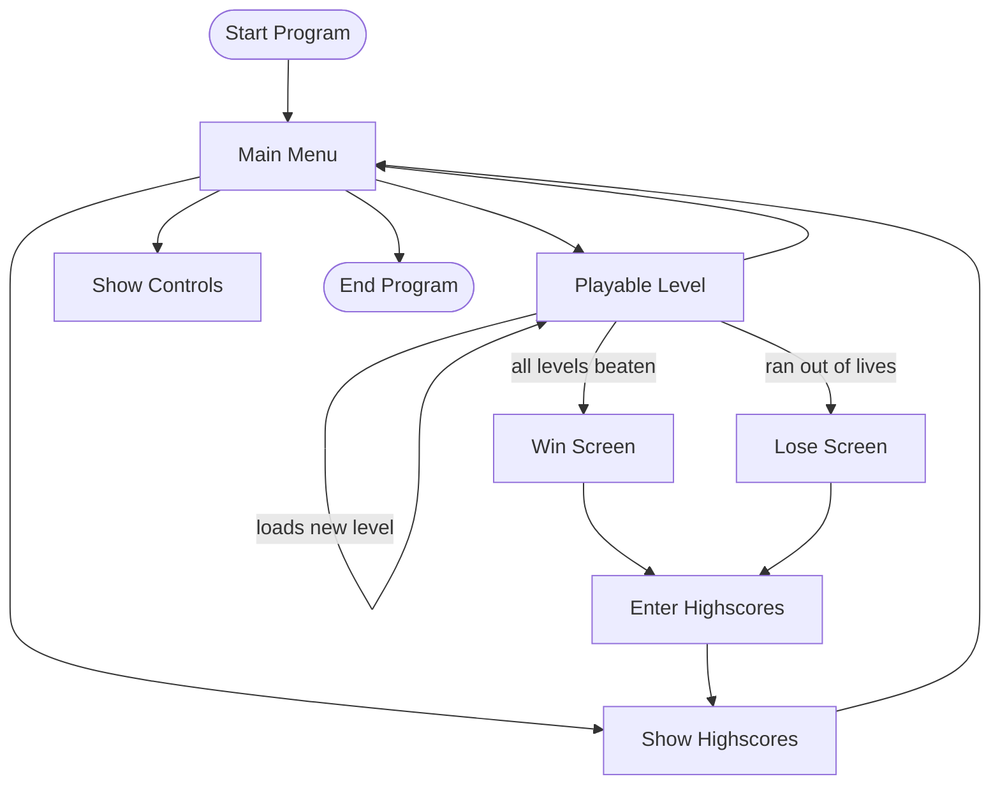

_This project has been created as part of the 42 curriculum by ldreger, mimeyer._

# Description

Pac-Man is a Python recreation of the classic maze game, developed for the 42
curriculum. Guide Pac-Man through generated mazes, collect pac-gums and
super pac-gums, avoid or eat the four ghosts, and try to complete each
configured level before time runs out. The game includes a main menu, gameplay,
win and game-over screens, a guide, and a persistent high-score table.

Our broad implementation utilizes pygame together with a centralized sprite sheet to balance current game development standards together with retro game restrictions. This game has also been published privately to [Itch.io](https://kiro6058.itch.io/pac-man-42); The project has not been made public because of respect to copyright laws.

# Instructions

## Requirements

- Python 3.13
- [uv](https://docs.astral.sh/uv/) for environment and dependency management
- A graphical desktop environment supported by Pygame

The project restricts Python to `>=3.13,<3.14`. The assigned MazeGenerator
package is included as a wheel in this repository.

## Installation and Running

From the repository root, install the project dependencies and start the game:

```sh
make install
make run
```

For controls, navigate to the "GUIDE" option in the main menu or see [Details](#controls).

---

By default, `make run` loads `data/config.json`. To use another configuration file, pass its path through `CONFIG`:

```sh
make run CONFIG=path/to/config.json
# Equivalent to: 
# uv run python3 -m src.pac_man path/to/config.json
```

For more info on availible configurations, see [Details](#the-configuration-file).

## All Makefile Rules

The Makefile supports multiple rules:

| Rule | Description |
| - | - |
| `all` | Equivalent to `install run`. This is the default. |
| `install` | Runs `uv sync` that installs/updates all dependencies. |
| `run` | Runs the program. |
| `debug` | Runs the program in debug mode (`pdb`). |
| `source` | Lists all python files inside of `src/pac_man`. |
| `lint` | Checks for lint and mypy compliance. |
| `build` | Creates a ready to be distributed game executable using `pyinstaller`. |
| `clean` | Removes python artifacts such as `__pycache__` and `.mypy_cache`. |
| `fclean` | Removes python artifacts in addition to artifacts and executable of `build`. |

# Resources

Multiple resources have been consulted in the development of this project. Some references such as MinilibX did not end up mattering in the final project since we changed to a pygame architecture.

- [42 Pac-Man project subject](https://projects.intra.42.fr/projects/pac-man)
- [Pygame documentation](https://www.pygame.org/docs/)
- [Python 3 documentation](https://docs.python.org/3.13/)
- [Pydantic documentation](https://docs.pydantic.dev/)
- [A-Maze-ing / MazeGenerator package](https://github.com/42school/AMazeing)
- [Pac-Man sprite resource reference](https://www.spriters-resource.com/arcade/pacman/)
- [MinilibX 42 Python documentation](https://github.com/SaraFreitas-dev/MinilibX-42-Pyhton-Documentation/blob/main/MLX_DOCUMENTATION.md)

AI assistance was used to inspect the existing project files and draft this
README, including its configuration, implementation, and architecture
descriptions. No AI-generated gameplay code or artwork is part of this
documentation change; this repository does not document other AI use.

# Details

The general game loop of this project is shown in the flowchart below. A flowchart representation is very fitting, since our practical implementation uses a [Finite State Machine](https://en.wikipedia.org/wiki/Finite-state_machine): We have one main loop that processes certain logic, called states, every frame. Note that we have another flowchart for gameplay this is not included here.



## Controls

The game opens in fullscreen. Controls can be found in the "GUIDE" option in the main menu:

| Action | Keys |
| - | - |
| Movement | WASD and Arrow keys |
| Pause | Space |
| Quit | Esc |
| Skip Level | Enter |
| Kill Pacman | Numpad1 |
| Gain 1UP | Numpad2 |
| Freeze Ghosts | Numpad3 |
| Scare Ghosts | Numpad5 |
| Speed Up Pacman | Page Up |
| Slow Down Pacman | Page Down |
| Cycle Text Color | Numpad7 |
| Cycle Wall Color | Numpad8 |

## The Configuration File

The game reads one configuration file path from the command line. The default is `data/config.json`; it is a JSON object that allows `#` and `//` comments, which are removed before parsing. Unknown keys will throw a warning in the console but are then ignored.

Configuration settings are:

| Key | Constraints | Default in `data/config.json` | Description |
| - | - | - | - |
| `highscore_filename` | `str` or `null` | `./data/highscore.json` | File used to load and save scores. If not set or invalid, no highscore data will be displayed nor saved; Any specified file may be overwriten. |
| `level_count` | `int >= 10` | `10` | Number of levels to be played. If this number is lower than defined overrides in `levels`, those levels will not be played. |
| `points.pacgum` | `int >= 0` | `10` | Points for a Pacgum. |
| `points.super_pacgum` | `int >= 0` | `50` | Points for a Super Pacgum. |
| `points.ghost` | `int >= 0` | `200` | Points for a ghost |
| `lives` | `100 >= int >= 1` | `3` | Lives to start out with. |
| `seed` | `int >= 0` | `67` | Seed fo the first maze generation. `0` will give an unreproducibly random maze. |
| `width`, `height` | `70 >= int >= 3` | `10` | Default maze dimensions. |
| `pacgums` | `int >= 0` | `0` | Number of Pacgums per level. Greater number than availible pacgum locations will be ignored. `0` fils all locations. |
| `super_pacgums` | `int >= 0` | `4` | Number of Super Pacgums to replace normal pacgums with. If this number is equal or greater to the number of pacgums, all pellets will be super. |
| `timer` | `int >= 20` | `90` | Time limit per level in seconds. |
| `levels` | ^ | -- | Optional per-level overrides of `width`, `height`, `pacgums`, `super_pacgums`, or `timer`. |

The values in the table are the checked-in configuration's values. If a setting is omitted, the code-level defaults are width 10, height 10, lives 3, pac-gums 0 (meaning all available positions), super pac-gums 4, timer 90 seconds, and a seed of 67.

For reference, here is the original configuration file:

```json
{
    "highscore_filename": "./data/highscore.json",
    "level_count": 10,
    "points": { "pacgum": 10, "super_pacgum": 50, "ghost": 200 },
    "lives": 3,
    "seed": 67,
    "width": 10,
    "height": 10,
    "pacgums": 0,
    "super_pacgums": 4,
    "timer": 90,
    "levels": [
        { "width": 7, "height": 7 },
        { "width": 15, "height": 13 },
        { "width": 5, "pacgums": 100 },
        { "width": 15, "height": 5, "pacgums": 50 },
        { "width": 15, "timer": 120 },
        { "width": 10, "height": 3, "pacgums": 30, "super_pacgums": 9999, "timer": 30 },
        { "width": 20, "height": 3, "pacgums": 50, "super_pacgums": 9999 },
        {},
        {},
        { "width": 70, "height": 70, "pacgums": 1, "super_pacgums": 0, "timer": 200 }
    ]
}
```

## Highscore

Scores are stored locally as a JSON object in the file named by
`highscore_filename`, with player names as keys and scores as values. After a
win or game over, a player can enter an alphanumeric name of up to ten
characters. The menu reads the saved data and presents it in descending score
order. A plain JSON file keeps scores persistent between runs while remaining
easy to inspect, back up, or reset without requiring a database.

## Maze Generation

Each level uses the assigned `mazegenerator` package, supplied in the repository
as `mazegenerator-2.1.0-py3-none-any.whl`. The game passes the configured width,
height, and seed to `MazeGenerator`; a `null` seed is replaced with a random
integer. The resulting maze is a matrix of integer wall masks. The tile model
decodes each mask into top, right, bottom, and left wall flags, then builds
neighbor references used for rendering and character movement. A fixed seed
makes the generated layout reproducible.

## Implementation

The game is written in Python and uses Pygame for the fullscreen window, event
loop, sprite groups, animation, input, and drawing. Pydantic validates the
configuration, while the included MazeGenerator wheel creates each maze.
Sprites are loaded and cached from `data/spritesheet.bmp`; the renderer builds
maze tiles from wall metadata and draws the player, ghosts, collectibles, and
HUD. Player movement follows keyboard input, while four ghosts use individual
movement behaviors and pathfinding. The game loop manages levels, timers,
lives, collisions, scoring, and transitions between screens.

## General Software Architecture

The application is organized under `src/pac_man/`:

- `__main__.py` is the executable entry point. It loads and validates the
    configuration, then owns the Pygame lifecycle through `LoopMachine`.
- `loop/` contains the outer finite-state machine, gameplay loop, level
    lifecycle, menus, guide, win/death screens, and high-score screens.
- `models/` defines tile metadata and sprite construction, shared character
    behavior, the Pac-Man player, and the four ghost personalities.
- `render/` handles the HUD, sprite-sheet loading/caching, and text rendering.
- `utils/` contains configuration parsing/validation and shared position and
    direction structures.

`LoopMachine` selects the current screen-level state. When gameplay starts, it
creates a `GameLoop`; that loop asks the maze package for a maze, creates a
`Level`, and advances its game-level states. A `Level` converts the maze into a
connected tile matrix, creates the player and ghosts, and coordinates the
rendering and collectibles. The renderer consumes those models to draw the
current frame, while the HUD displays time, lives, and score.

## Project Management

We coordinated the project through GitHub, used Miro for collaborative
planning, used a since removed TODO.md file for coordination, and held frequent meetings to review progress and decide next steps.

We initally tried to work with a subject recommended MiniLibX library for this project, but quickly ran into implementation independent bottlenecks. We switched to pygame for game logic since this is the industry standard for simple python games, while still maintaining a low-level retro implementation by using just one sprite sheet for rendering.

| ldreger | mimeyer |
| - | - |
| Sprite rendering | FSM architecture |
| Configuration file parsing | Highscore file reading and writing |
| MazeGenerator implementation | Main run loop implementation |
| General Character Movement Logic | Main Menu and Guide |
| HUD implementation and text rendering | Ghost AI with Super Pacgum logic |
| Pallet Generation | Logging |

The GitHub repository is
[MikMey/PacMan](https://github.com/MikMey/PacMan); the Miro board link is not
stored in this repository.
